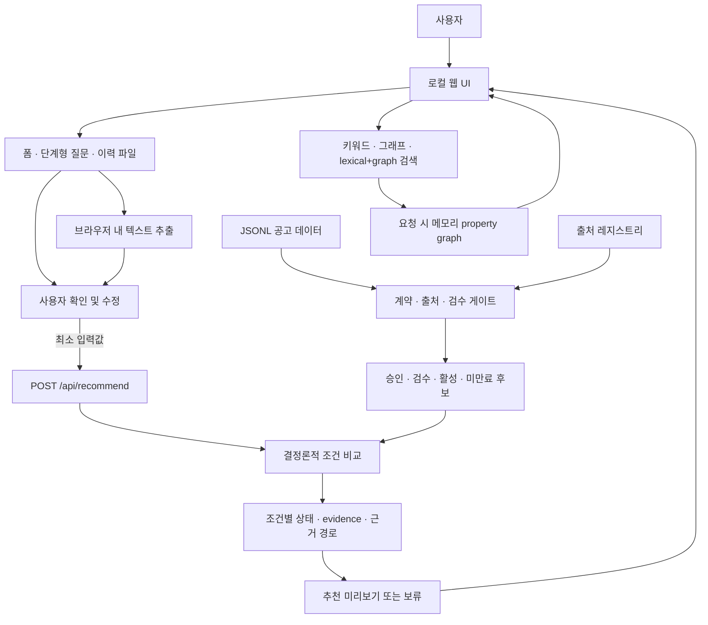

# 부울경 일자리 탐색 · 개인 이력 기반 채용공고 비교

> **사용자가 확인한 이력·희망 조건과 근거가 확인되는 채용공고를 비교해, 후보와 확인할 점을 투명하게 보여주는 로컬 PoC입니다.**
>
> 현재 구현은 **합성 데이터 기반 vertical slice**입니다. 실제 채용공고 이용 승인, 실제 추천 품질 검증, 운영 서비스 배포를 의미하지 않습니다.

| 프로젝트 상태 | 현재 기준 |
| --- | --- |
| 제품 방향 | 개인이 제공·검토한 정보와 채용공고의 조건을 근거 중심으로 비교 |
| 데모 데이터 | 합성 공고만 사용 — `data/demo_jobs.jsonl` |
| 실행 방식 | 로컬 웹 UI, 브라우저에서 `127.0.0.1`로 접속 |
| 추천 목적 G0 | 별도 범위 보완 필요 |
| 고용24 API | 목록 XML 클라이언트 및 모의 전송 테스트 추가; 로컬 UI·DB에 미연동, 인증된 호출·실공고 취득 없음 |
| 출처별 G1 / 실데이터 G2 | 권한 확인 대기 / 실행 차단 |
| 운영 공개 | 인증·접근통제·TLS 미구현으로 금지 |

## 한눈에 보기

이 프로젝트는 단순한 키워드 검색이나 자동 합격 예측이 아닙니다. 사용자가 확인한 이력·희망 조건을 입력하면, 시스템이 **승인·검수된 공고 후보를 결정론적으로 비교**하고 각 결과의 근거와 확인 필요 항목을 제시하는 것을 목표로 합니다. 이력에 없는 내용은 역량 부족으로 간주하지 않으며, 적합도 점수를 취업·합격 확률로 해석하지 않습니다.

- **근거 우선:** 공고의 출처·필드 evidence가 확인되는 내용만 비교 사유로 사용합니다.
- **사람이 최종 확인:** 파일·대화에서 추출한 기술은 후보이며, 사용자가 수정·확인한 값으로 매칭합니다.
- **비저장 우선:** 프로필과 업로드 원문을 서버에 영속 저장하지 않는 흐름입니다.
- **안전한 보류:** 필수 조건·공고 상태·근거를 확인할 수 없으면 후보에서 제외하거나 미확인으로 표시합니다.

## 아키텍처와 데이터 흐름

아래 흐름은 현재 로컬 구현을 나타냅니다. 검색의 메모리 그래프와 추천 비교 로직은 구분되어 있습니다. **Neo4j, 벡터 DB, 임베딩, LLM은 사용하지 않습니다.**



### 결과가 만들어지는 과정

1. **공고 데이터 로드:** 서버 시작 시 JSONL을 읽습니다. 합성 자료는 `--allow-synthetic`을 명시해야 사용됩니다. 비합성 자료는 출처 레지스트리·계약·검수 조건을 통과해야 합니다.
2. **품질·노출 게이트:** 데이터 계약에 맞지 않거나 출처가 승인되지 않은 레코드, 검수 미완료 공고는 검색·추천 결과에 노출하지 않습니다.
3. **사용자 입력:** 사용자는 기술, 희망 직무·지역·급여 등 지원 조건을 직접 입력하거나 단계형 질문에 답합니다. 파일을 사용하면 추출된 후보를 검토·수정합니다.
4. **브라우저 내 추출:** TXT/Markdown은 기본 처리합니다. PDF.js/Mammoth는 필요 시 CDN에서 내려받아 PDF/DOCX 텍스트를 브라우저에서 처리합니다. 파일 원문은 서버에 업로드하지 않습니다.
5. **일회성 비교:** 확인된 기술 키워드와 사용자가 선택한 조건을 `POST /api/recommend`로 전달합니다. 서버는 적격 공고를 필터링하고 필수·선호 조건과 근거 있는 기술을 결정론적으로 비교합니다.
6. **설명 가능한 결과:** 조건별 일치·불일치·미확인, 공고 evidence, 일치 기술 및 이력 미기재(확인 필요)를 표시합니다. 필수 조건 실패나 근거·모집 상태가 불충분하면 제외 또는 보류합니다.
7. **사용자 판단:** 결과는 탐색을 돕는 비교 정보입니다. 지원 자격, 채용 가능성 또는 취업·합격 확률을 판정하지 않습니다.

> **GraphRAG 범위:** 현재 검색의 그래프는 요청 시 메모리에 만드는 결정론적 property graph이며, 검색 결과에 관계 경로와 evidence를 붙이는 데 사용합니다. 추천은 그래프가 자율적으로 결론을 내리는 기능이 아니라 일반 코드의 조건 비교입니다. 영속 그래프 DB·벡터 검색·LLM 답변 생성은 구현되어 있지 않습니다.

## 추천 결과에서 보는 것

| 결과 항목 | 의미 |
| --- | --- |
| 조건 상태 | 일치 / 불일치 / 미확인. 필수 조건 실패는 선호 조건 점수로 상쇄하지 않음 |
| 기술 일치 | 사용자가 확인한 이력 기술과 공고 evidence가 있는 요구 기술의 비교 |
| 이력 미기재 | 능력 부족이 아니라 이력에서 확인되지 않은 항목. 사용자 확인이 필요한 상태 |
| 공고 정보 미확인 | 출처 evidence 또는 모집 상태가 충분하지 않아 판단할 수 없는 항목 |
| 추천 보류 | 적절한 후보·근거가 없거나 필수조건/최신성이 확인되지 않을 때 결과를 과장하지 않음 |

현재 추천 점수는 결정론적 초기 기준선입니다. 합성 회귀 세트는 기능 동작만 확인하며 실제 추천 품질이나 사용자 성과를 입증하지 않습니다.

## 현재 구현과 한계

**구현된 로컬 vertical slice**

- JSONL 계약 검증, 품질 보고, 중복·오류 처리와 출처 레지스트리 확인.
- 키워드 검색, 결정론적 그래프 데모, lexical+graph 하이브리드 검색과 evidence 표시.
- 추천 미리보기 API, 필수·선호조건 필터, 근거 기반 이력 기술 비교.
- 웹 UI의 직접 입력, 규칙 기반 단계형 챗봇, TXT/Markdown/PDF/DOCX 기술 후보 추출.
- 사용자 프로필·조건·업로드 원문을 서버에 영속 저장하지 않는 요청 흐름.

**미구현 또는 미승인**

- 실제 데이터 사용 승인 및 실제 공고에 대한 relevance 평가.
- Work24 API 클라이언트는 목록 XML 요청·파싱용 격리 모듈이며 아직 앱·DB에 연결하지 않음. 실제 인증 호출·데이터 변환·저장·승인은 미완료. Neo4j·벡터 DB·임베딩·LLM도 미구현.
- OCR(스캔 PDF), 구형 DOC, 자동 개인정보 제거, 정교한 이력서 파싱.
- 로그인, 다중 사용자 권한, 운영 TLS, CSRF 보호, 운영 모니터링·감사.
- 프로필 저장·재방문, 자유 대화형 AI, 취업/합격 확률 예측.

## 빠른 시작

저장소 루트에서 실행합니다.

```bash README.md
python -m src.app.web --data data/demo_jobs.jsonl --allow-synthetic --host 127.0.0.1 --port 8000
```

브라우저에서 `http://127.0.0.1:8000`을 엽니다. 합성 데이터가 아닌 파일을 연결하거나 네트워크에 공개하지 마세요. 종료는 별도 터미널에서 서버 프로세스를 찾아 중지할 수 있습니다.

```bash README.md
pkill -f '^python -m src.app.web'
```

검색·그래프 데모와 회귀 검증:

```bash README.md
python -m src.app.cli --data data/demo_jobs.jsonl --allow-synthetic --query Python
python -m src.app.cli --data data/demo_jobs.jsonl --allow-synthetic --graph --query Python --region 부산
python -m src.app.evaluate --data data/demo_jobs.jsonl --allow-synthetic --cases data/retrieval_eval_synthetic.json --recommendation-cases data/recommendation_eval_synthetic.json --k 5
python -m unittest discover -s tests -v
```

평가·테스트 결과는 합성 fixture의 기능 회귀에 한정됩니다. 실제 공고 검색·추천 품질의 증거로 해석하지 않습니다.

## 개인정보와 안전 경계

- 이력 파일은 브라우저에서 읽고, 서버로는 기술 후보와 사용자가 선택한 조건만 일회성 요청으로 전달합니다. 이름·연락처·이메일·주소 등은 파일을 선택하기 전에 직접 제거하세요.
- PDF/DOCX 분석은 인터넷 연결 시 PDF.js/Mammoth 라이브러리를 CDN에서 내려받습니다. 파일 내용은 CDN으로 보내지 않지만, 오프라인에서는 TXT/Markdown을 사용하세요.
- 검색 질의는 URL에 포함될 수 있어 브라우저 기록·공유 링크 노출에 유의하세요. `/api/recommend`는 POST body를 사용합니다.
- 이 로컬 PoC에는 사용자 인증, 역할 기반 접근통제, 운영용 TLS 및 완전한 CSRF 방어가 없습니다. `0.0.0.0`으로 공개하거나 실제 개인정보·실데이터를 서비스하지 마세요.
- 추천 결과는 채용 결정·지원 자격 판정이 아닙니다. 이력 미기재는 역량 부족의 증거가 아니며, 근거가 부족하면 추천을 보류합니다.

## 데이터 이용 승인 게이트

| 단계 | 상태 | 다음 통과 조건 |
| --- | --- | --- |
| 합성 데이터 데모 | 구현됨 | 로컬 기능·회귀 확인만 가능 |
| 추천 목적 범위(G0) | 보완 필요 | 개인 이력 비교, 추천 표시·정렬, 이용자 범위와 비저장 원칙을 별도 기록·승인 |
| 출처 이용(G1) | 대기 중 | 출처별 저장·정규화·내부 분석·화면 표시·추천·인용·보존/삭제 권한 확인 |
| 소량 파일럿(G2) | 차단 | G0/G1 및 개인정보·보안 승인을 통과한 뒤 별도 실행 승인 |
| 사용자 파일럿·운영 공개 | 미승인 | 사용자 고지/동의, 삭제·접근통제·운영 보안·평가 기준 수립 |

기존 08번 G0는 초기 공고 분석 범위의 결정 기록이며, 개인 이력 기반 추천까지 승인한 것이 아닙니다. 사용자는 고용24 인증키를 로컬 `.env`에 저장했다고 보고했으나, 앱은 이 값을 읽거나 API를 호출하지 않습니다. 목록 XML 클라이언트는 분리 구현되어 있으나 승인 확인 전 실제 키를 이용한 호출은 하지 않았습니다. 키 발급은 출처 이용 허가가 아니므로 권한 확인 전에는 합성 자료만 사용합니다.

## 문서 안내

- **현재 기준과 문서 관계:** [00 문서 구성 및 현재 기준](docs/00_문서_구성_및_현재기준.md)
- **제품 방향·추천 계약:** [13 추천 시스템 전환·통합 업그레이드 계획](docs/13_recommendation_upgrade_plan.md), [14 개인 이력 기반 전환안](docs/14_개인이력_기반_채용공고_미스매칭_추천_전환안.md)
- **실행·현재 기술 흐름:** [07 로컬 GraphRAG 데모](docs/07_통합흐름_로컬_GraphRAG_데모.md), [11 웹 UI 실행 가이드](docs/11_웹_UI_MVP_실행가이드.md), [12 검색·GraphRAG 구현 계획](docs/12_GraphRAG_기능구현_단계계획.md)
- **데이터 승인·품질·파일럿:** [03 품질 관리](docs/03_데이터_확보_및_품질관리.md), [05 G0/G1 작업 기준](docs/05_G0_G1_작업기준_및_G2_착수.md), [06 출처 후보 검토](docs/06_G1_공식출처_후보_검토.md), [09 G2 파일럿 착수안](docs/09_G2_소량_파일럿_착수안.md), [10 이용조건 문의안](docs/10_G1_한국고용정보원_이용조건_확인요청안.md)
- **초기 범위 기록:** [01 아키텍처 초안](docs/01_GraphRAG_프로젝트_아키텍처_초안.md), [02 15일 PoC 계획](docs/02_PoC_15일_실행계획.md), [08 G0 결정 기록](docs/08_G0_범위_결정안.md). 초기 기록과 현행 구현의 차이는 00번 문서를 기준으로 확인하세요.

## 주요 코드 경로

| 경로 | 역할 |
| --- | --- |
| `src/app/web.py` | 로컬 웹 UI와 HTTP API |
| `src/app/cli.py` | 로컬 검색·그래프 데모 CLI |
| `src/app/evaluate.py` | 검색·추천 합성 평가 실행기 |
| `src/retrieval/` | 검색, 그래프, 추천 비교 로직 |
| `src/domain/` | 공고 데이터 계약·검증 모델 |
| `src/ingestion/work24_client.py` | Work24 목록 XML 클라이언트; 앱/DB에는 미연동, 실제 호출은 승인 후에만 |
| `data/demo_jobs.jsonl` | 합성 공고 fixture — 실제 공고 자료가 아님 |

---

**이 프로젝트가 보여주는 것은 설명 가능한 비교 흐름의 기술적 프로토타입입니다.** 실제 출처 권한, 추천 효용, 개인정보 보호 인증 또는 운영 안전성이 검증되었다는 의미는 아닙니다.
