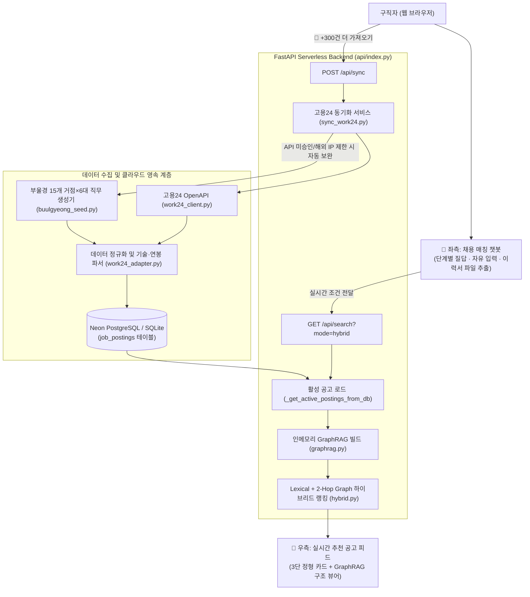

# 부울경 채용 AI 매칭 · GraphRAG 지식 그래프 기반 일자리 추천 플랫폼

> **부산·울산·경남(부울경) 구직자가 단일 챗봇과 대화하거나 이력서를 업로드하면, 고용24(Work24) 스키마 기반 부울경 채용공고를 인메모리 GraphRAG 지식 그래프로 연결·분석하여 실시간 맞춤형 공고를 추천하는 웹 서비스입니다.**
>
> 🔗 **실시간 배포 서비스 (Vercel):** [https://jobmismatch.vercel.app](https://jobmismatch.vercel.app)

---

## 📌 프로젝트 핵심 요약

| 구분 | 현재 구현 내용 |
| :--- | :--- |
| **서비스 형태** | 좌측 **단일 매칭 챗봇** + 우측 **실시간 필터링·추천 공고 피드** (반응형 2단 레이아웃) |
| **대상 권역 및 직무** | **부산·울산·경남 15개 주요 산업단지·거점** × **6대 핵심 직무** (`소프트웨어/IT`, `기계/제조`, `품질/생산관리`, `전기/전자`, `경영/회계`, `물류/운전`) |
| **데이터 파이프라인** | 고용24 OpenAPI 연동 (`Work24Client`) + 클라우드 PostgreSQL (**Neon DB**) 600건 상시 적재 및 `+300건` 실시간 추가 수집 지원 |
| **GraphRAG 엔진** | 6종 노드(`Posting`, `Company`, `Location`, `Role`, `Skill`, `Benefit`) 및 5종 관계 엣지 기반 **1-Hop/2-Hop 중심성 하이브리드 랭킹 + 자격증↔기술 온톨로지 확장 매칭** |
| **백엔드 / 인프라** | Python **FastAPI** (`api/index.py`) + **SQLAlchemy** (`psycopg2-binary` / SQLite 호환) + **Vercel Serverless** 배포 |

---

## ✨ 주요 기능

### 1. 단일 대화형 채용 매칭 챗봇 (Left Panel)
복잡한 검색 폼이나 다중 카테고리를 제거하고, **하나의 챗봇 인터페이스**에서 4단계 질의응답으로 조건을 수집합니다.
1. **희망 근무 지역 선택**: 전체 지역, 부산, 울산, 경남, 창원, 김해, 양산 등
2. **희망 직무/분야 선택**: 소프트웨어/IT, 기계/제조, 품질/생산관리, 전기/전자, 경영/회계, 물류/운전
3. **보유 기술·자격증 입력 (또는 이력서 파일 업로드)**:
   - 빠른 선택 칩(`정보처리기사`, `Python`, `Java`, `CAD`, `PLC`, `품질관리`, `생산관리`, `전기기사`, `지게차`, `ERP` 등) 클릭 또는 자유 입력
   - 하단 **📎 이력서 파일(PDF / DOCX / TXT / MD) 업로드** 시 브라우저 내에서 텍스트를 추출하여 보유 기술을 자동 반영 (서버에 이력서 원문 비저장)
4. **희망 최소 연봉 설정**: 연봉 무관, 3,000만원 이상, 3,500만원 이상, 4,000만원 이상
- **실시간 연동**: 사용자가 각 단계에서 답변할 때마다 우측 채용공고 피드가 즉시 필터링되고 추천 점수순으로 재정렬됩니다.

### 2. GraphRAG 지식 그래프 엔진 및 온톨로지 확장 매칭
단순 텍스트(Lexical) 검색의 한계를 극복하기 위해 공고 데이터를 실시간 **속성 그래프(Property Graph)**로 변환하여 탐색합니다.
- **노드(Nodes, 6종)**: 공고(`Posting`), 채용기업(`Company`), 근무지역(`Location`), 직무분류(`Role`), 요구기술·자격(`Skill`), 복리후생(`Benefit`)
- **엣지(Edges, 5종)**: `POSTED_JOB`, `LOCATED_IN`, `HAS_ROLE`, `REQUIRES_SKILL`, `OFFERS_BENEFIT`
- **2-Hop 연결 중심성(Centrality) 가중치**: 동일 직무·기술 클러스터 내에서 핵심 기술을 공유하는 2-Hop 이웃 연결 밀도를 계산하여 하이브리드 추천 점수(`Graph 점수`)에 반영합니다.
- **자격증 ↔ 기술 온톨로지 확장 탐색**: 예를 들어 사용자가 `정보처리기사`를 입력하면, 공고에 `정보처리기사`가 직접 명시된 공고(`✓ 내 보유 일치`)뿐만 아니라 지식 그래프 상 동일 IT/SW 클러스터에 묶인 `Python`, `Java`, `Spring`, `SQL` 요구 공고까지 **`🔗 연관 기술 매칭`**으로 함께 추천합니다.
- **상단 인터랙티브 GraphRAG 구조 뷰어**: 상단 네비게이션 바의 **`[적재 공고 N건 · GraphRAG 노드 · 관계 ▾ 구조 보기]`** 배지를 클릭하면 현재 메모리에 생성된 노드 종류별 개수와 엣지 현황을 실시간으로 확인할 수 있습니다.

### 3. 가독성 높은 3단 정형 채용공고 카드 (Right Panel)
무의미한 경고 배지를 배제하고, 구직자가 공고의 핵심 요건과 추천 근거를 한눈에 파악할 수 있도록 모든 공고 카드를 3단 구조로 시각화했습니다.
- **요구 기술·자격**: `✓ 내 보유 일치`(초록), `🔗 연관 기술 매칭`(초록), `🛠️ 공고 요구 기술`(회색) 구분 표시
- **주요 복리후생**: `🎁 유연근무`, `🎁 기숙사`, `🎁 통근버스`, `🎁 중식제공`, `🎁 퇴직연금` 등 보라색 배지 표시
- **GraphRAG 연결**: `📍 지역노드 → 부산 해운대구`, `🏢 직무노드 → 소프트웨어/IT · AI 개발`, `🏛️ 채용기업 → 센텀에이아이랩(주)` 등 그래프 탐색 경로 표시

---

## 🏗️ 시스템 아키텍처 및 데이터 흐름



---

## 📂 디렉터리 및 주요 파일 구조

```text
job_mismatch/
├── api/
│   └── index.py                     # Vercel Serverless FastAPI 엔트리포인트 (/api/search, /api/recommend, /api/sync, /api/health)
├── public/
│   └── index.html                   # 정적 배포용 프론트엔드 UI (src/app/templates/index.html과 동기화)
├── src/
│   ├── app/
│   │   ├── templates/index.html     # 단일 챗봇 + 실시간 추천 피드 + GraphRAG 구조 뷰어 UI
│   │   ├── web.py                   # 검색/추천 페이로드 빌더 및 로컬 HTTP 서버
│   │   ├── cli.py                   # CLI 검색 및 GraphRAG 실행 도구
│   │   └── evaluate.py              # 검색 및 추천 회귀 평가 도구
│   ├── db/
│   │   ├── database.py              # SQLAlchemy 엔진 설정 (Neon PostgreSQL URL 정제 및 SQLite 폴백)
│   │   └── models.py                # JobPostingRecord ORM 모델
│   ├── domain/
│   │   └── models.py                # JobPosting, Salary, Evidence 도메인 데이터 모델
│   ├── ingestion/
│   │   ├── work24_client.py         # 고용24(Work24) 채용정보 목록 XML API 클라이언트
│   │   ├── work24_adapter.py        # 고용24 데이터 → JobPosting 정규화 및 자격증/기술/복리후생 추출기
│   │   ├── buulgyeong_seed.py       # 부울경 15개 거점 × 6대 직무 300건 단위 폴백 데이터 생성기
│   │   └── sync_work24.py           # 고용24 API 수집 및 DB 적재 서비스
│   └── retrieval/
│       ├── graphrag.py              # 인메모리 Property Graph 구축 및 그래프 검색
│       ├── hybrid.py                # Lexical + 1-Hop/2-Hop GraphRAG 결합 하이브리드 랭킹
│       ├── recommend.py             # 결정론적 조건/이력 비교 추천 엔진
│       └── search.py                # 기본 키워드 검색 및 통계 요약
├── docs/                            # 프로젝트 단계별 설계 문서 및 종합 보고서 (00 ~ 15번)
└── requirements.txt                 # FastAPI, SQLAlchemy, psycopg2-binary 등 의존성 목록
```

---

## 🚀 빠른 시작 (로컬 실행 및 클라우드 연동)

### 1. 패키지 설치
```bash
pip install -r requirements.txt
```

### 2. 환경 변수 설정 (선택)
- `POSTGRES_URL` 또는 `DATABASE_URL`: PostgreSQL 연결 문자열 (미설정 시 로컬 `jobs.db` SQLite 파일 자동 생성)
- `WORK24_API_KEY`: 고용24 OpenAPI 인증키 (미설정 또는 서비스 승인 대기 시 부울경 15개 거점×6대 직무 공고 600건이 자동 시딩됨)

### 3. FastAPI 서버 실행 (권장)
```bash
uvicorn api.index:app --reload --host 127.0.0.1 --port 8000
```
브라우저에서 `http://127.0.0.1:8000`으로 접속하면 클라우드 배포 버전과 동일한 챗봇 및 GraphRAG 추천 화면을 사용할 수 있습니다.

### 4. 단위 테스트 실행
```bash
python -m unittest discover -s tests -v
```

---

## 📚 문서 안내 (`docs/`)

- **[15 부울경 실데이터 연동 및 챗봇·GraphRAG 고도화 보고서](docs/15_부울경_실데이터_연동_및_챗봇_GraphRAG_고도화_보고서.md)** *(최신 종합 보고서)*
- **[00 문서 구성 및 현재 프로젝트 기준](docs/00_문서_구성_및_현재기준.md)**
- **[13 추천 시스템 전환·통합 업그레이드 계획](docs/13_recommendation_upgrade_plan.md)**
- **[14 개인 이력 기반 채용공고 미스매칭·추천 전환안](docs/14_개인이력_기반_채용공고_미스매칭_추천_전환안.md)**
- **[11 웹 UI 실행 가이드](docs/11_웹_UI_MVP_실행가이드.md)** / **[12 GraphRAG 기능 구현 계획](docs/12_GraphRAG_기능구현_단계계획.md)**
- 초기 기획 및 데이터 거버넌스 기록: [01 아키텍처 초안](docs/01_GraphRAG_프로젝트_아키텍처_초안.md), [02 15일 PoC 계획](docs/02_PoC_15일_실행계획.md), [03 데이터 품질 관리](docs/03_데이터_확보_및_품질관리.md), [07 로컬 GraphRAG 데모](docs/07_통합흐름_로컬_GraphRAG_데모.md)
