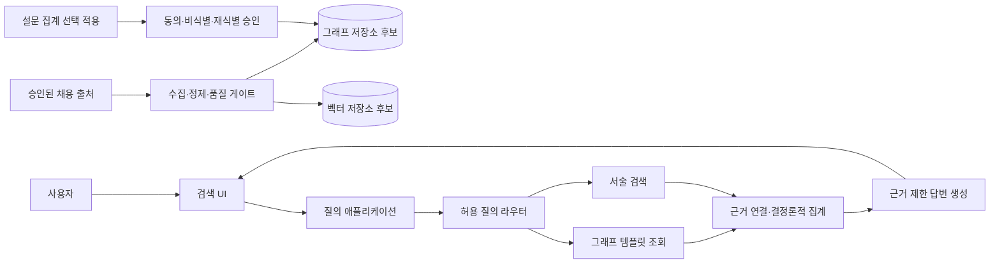

# 01 — 부울경 청년 일자리-기업 미스매칭 GraphRAG 프로젝트 아키텍처

> 기준: 종합계획서 1. 추진 배경·목표. PoC 범위 및 진행 일정은 [02_PoC_15일_실행계획.md](02_PoC_15일_실행계획.md)를 참조한다.
> 상태: 설계 및 로컬 스캐폴드. 출처·이용 조건·범위 승인이 끝나기 전까지 실제 수집, 외부 모델 호출, 운영 계정 연결은 금지한다.

## 1. 목표와 해석 경계

15영업일 PoC의 목표는 한정된 권역·직무·기간에서 승인된 채용 공고의 구조화된 조건과 서술 근거를 연결하고, 그래프 관계·집계 검색과 벡터 기반 서술 검색의 기술적 타당성 및 근거 추적성을 검증하는 것이다. 구조화된 정보는 그래프 검색으로, 직무·자격·복지 서술은 출처 메타데이터를 보존하는 의미 검색으로 보완한다.

결과는 관찰한 공고 범위에 한해서만 해석한다. 부울경 청년 전체의 선호나 유출 원인, 기업 구인난의 인과관계, 취업·정착률 또는 정책 효과를 입증하지 않는다. 근거 부족·범위 초과는 추측하지 않고 미확인으로 처리한다.

## 2. 원칙

- **근거 우선:** 답변을 공고 ID, 출처, 게시 시점, 원문 인용 위치까지 추적한다.
- **원문·정규화 분리:** 원문, 정규화 값, 변환·검수 상태와 버전을 함께 보존한다.
- **결정론적 집계:** 수치·분모·급여 통계는 검증된 코드/쿼리로 계산하고 LLM에 계산을 맡기지 않는다.
- **결측 보존:** 미기재·협의·해당 없음·추출 실패·검수 대기를 구별한다. 미기재를 0이나 미제공으로 바꾸지 않는다.
- **개인정보 최소화:** 설문 개인 응답은 적재하지 않는다. 승인된 비식별 집계도 동의·분모·소수 셀·재식별 검토 뒤 승인 게이트를 거친다.
- **최소 권한:** 조회 앱은 읽기 전용이며, 적재 권한과 비밀정보를 분리한다.
- **조건부 기술 선택:** Neo4j·벡터 DB·LLM·Streamlit은 이용 조건·비용·보안·팀 역량 확인 후 선택한다.

## 3. 논리 아키텍처

## 4. 데이터·질의 흐름

**적재:** 승인 출처 → 원본 스냅샷 → 스키마·중복·범위 검증 → 정규화 후보와 원문 위치 연결 → 사람 검수 → 데이터 버전 고정 → 그래프·벡터 인덱스 적재. 이용 조건이 불명확한 자료는 수집·외부 전송·적재하지 않는다.

**질의:** 선정 범위 확인 → 의도 분류 → 매개변수형 그래프 조회 및/또는 근거 메타데이터가 연결된 서술 검색 → 공고 ID로 결과 통합 → 결정론적 집계와 출처 검증 → 검증된 근거만으로 요약 → 출처·표본 범위·결측·한계를 화면에 표시. 임의 Text2Cypher는 기본 기능에서 제외한다.

## 5. 핵심 컴포넌트

| 컴포넌트 | 책임 |
| --- | --- |
| 출처 레지스트리·수집기 | 이용 승인, 수집 시점, 출처 및 이용 조건 기록 |
| 파서·정규화기 | 지역·직무·급여·스킬·복지의 정규화 후보와 원문 위치 생성 |
| 품질 게이트 | 필수값·중복·범위·결측·출처·검수 상태 확인 및 격리 |
| 그래프·벡터 어댑터 | 승인된 동일 데이터 버전 적재·검색·재색인 |
| 질의 라우터 | 허용된 검색 경로 및 매개변수형 템플릿 선택 |
| 근거·집계 서비스 | 출처 연결, 단위·분모 포함 결정론적 계산 |
| 답변/UI | 검증된 근거에 한정한 요약, 인용·결측·한계 표시 |
| 평가 도구 | 고정 질의·기대 결과·안전성 회귀 테스트 |

## 6. 그래프 모델 초안

중심 노드는 `JobPosting`이다. 후보 노드: `Company`, `Role`, `Skill`, `Benefit`, `Location`, `IndustrialComplex`, `Source`, 승인된 경우에 한한 `PreferenceAggregate`. 후보 관계는 `Company-POSTED_JOB->JobPosting`, `JobPosting-HAS_ROLE->Role`, `JobPosting-REQUIRES_SKILL->Skill`, `JobPosting-OFFERS_BENEFIT->Benefit`, `Company-LOCATED_AT->Location`, `JobPosting-FROM_SOURCE->Source` 등이다. 실제 근거가 있는 관계만 저장하고 필수/우대 구분과 원문 증거를 보존한다. 개인별 `SurveyResponse` 노드는 만들지 않는다.

급여는 원문·상태·하한/상한·단위를 함께 저장한다. 미기재·협의·단위 불명은 수치 기본값으로 바꾸지 않는다. 표시명만을 고유 ID로 쓰지 않는다.

## 7. 저장소 경계 및 안전

코드는 `src/domain/`, `src/ingestion/`, `src/retrieval/`, `src/answering/`, `src/storage/`, `src/app/`, `tests/`로 책임을 분리한다. 원본·색인 자료는 버전 관리에서 제외하고, 실제 자격증명은 문서·테스트·로그에 넣지 않는다.

Text2Cypher를 추후 검토하더라도 읽기 전용 계정, 허용된 라벨·관계·속성, 쿼리 검증 및 시간·행 제한을 먼저 적용한다. 공고 원문은 신뢰할 수 없는 입력으로 취급한다. 외부 LLM/임베딩 전송은 출처 이용 조건과 제공자 보안·보관 정책 승인을 통과한 최소 데이터에만 허용한다. 그래프와 벡터 색인은 동일 데이터 버전으로 유지한다.

## 8. 실행 게이트 및 현재 상태

| 게이트 | 산출물 | 통과 기준 |
| --- | --- | --- |
| A. 범위·환경 | 권역·직무·기간·출처·저장 위치 결정 | 이용 근거와 책임자 확인 |
| B. 데이터 계약 | 스키마·결측·검수·버전 규칙 | 승인 샘플 검수 완료 |
| C. 저장소 | DB·제약조건·인덱스 선택 | 재적재 및 출처 추적 재현 |
| D. 검색 MVP | 허용 템플릿·서술 검색·근거 패키지 | 고정 질의에서 결과 재현 |
| E. UI·검증 | 출처·표본·한계 화면, 테스트 | 안전성·회귀 기준 충족 |

현재 저장소에는 로컬 JSONL 데이터 계약/검수와 결정론적 키워드 검색 스캐폴드만 구현되어 있다. 합성 데모 자료 외의 실제 자료는 승인 전이다. Neo4j·벡터 DB·LLM·최종 UI 연동은 완료된 것으로 간주하지 않는다. 다음 단계는 02번 실행계획에 따라 범위와 출처 이용 조건을 확정하는 것이다.
