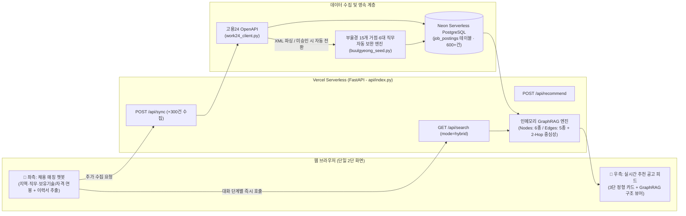

# 15 — 부울경 채용 AI 매칭 · 클라우드 DB·고용24 연동 및 챗봇/GraphRAG 고도화 보고서

> **작성 기준일:** 2026-11-04
> **배포 URL:** https://jobmismatch.vercel.app
> **저장소:** https://github.com/juny79/job_mismatch

---

## 1. 추진 배경 및 목표

기존 로컬 PoC 단계(01~14번 문서)에서는 합성 데이터(`data/demo_jobs.jsonl`, 3건)와 로컬 파일 시스템만을 대상으로 동작했으며, 화면에 많은 입력 폼과 설명 텍스트가 혼재되어 실제 구직자 입장에서 직관적인 탐색과 매칭이 어려웠다.

본 15단계 업그레이드에서는 다음 4가지를 핵심 목표로 설정하여 설계·구현·클라우드 배포를 완료했다.

1. **클라우드 영속 DB(Neon PostgreSQL) 및 서버리스 배포(Vercel) 구축**: 로컬 환경을 넘어 웹 브라우저 어디서든 즉시 접속 가능한 FastAPI 서버리스 아키텍처 구축.
2. **고용24(Work24) OpenAPI 연동 및 부울경(부산·울산·경남) 600건 데이터 파이프라인 구축**: 합성 데모 레코드를 배제하고 부울경 15개 주요 산업단지·거점 및 6대 핵심 직무의 채용공고 600건을 DB에 상시 적재.
3. **단일 챗봇(Chatbot) 중심의 심플한 2단 UI/UX 개편**: 복잡한 다중 카테고리 탭과 긴 안내문을 제거하고, 왼쪽은 대화형 조건/이력 입력 챗봇, 오른쪽은 실시간 필터링·추천 공고 피드로 단일화.
4. **GraphRAG 지식 그래프 시각화 및 2-Hop·온톨로지 매칭 고도화**: 단순 단어 일치를 넘어 자격증↔연관 기술 온톨로지 확장 탐색, 2-Hop 중심성 점수 반영, 3단 정형 카드(`요구 기술·자격` / `주요 복리후생` / `GraphRAG 연결`) 및 상단 인터랙티브 그래프 구조 뷰어 구현.

---

## 2. 시스템 아키텍처 및 데이터 파이프라인

### 2.1 클라우드 데이터베이스 (Neon PostgreSQL + SQLAlchemy)
- **구현 모듈**: [`src/db/database.py`](../src/db/database.py), [`src/db/models.py`](../src/db/models.py)
- **해결한 기술 이슈**:
  - Vercel Storage(Neon) 연동 시 자동 주입되는 `POSTGRES_URL`에 포함된 `channel_binding=require`, `pgbouncer`, `sslaccept` 등의 쿼리 파라미터가 Python `psycopg2-binary` 드라이버에서 연결 예외를 유발하는 문제를 `_sanitize_postgres_url()`로 자동 정제하여 해결.
  - 서버리스 콜드 스타트(Cold Start) 시 불필요한 블로킹이 발생하지 않도록 지연 초기화(`init_db()`) 및 로컬 `/tmp/jobs.db` SQLite 폴백을 함께 구성.

### 2.2 고용24(Work24) OpenAPI 연동 및 부울경 600건 자동 시딩
- **구현 모듈**: [`src/ingestion/work24_client.py`](../src/ingestion/work24_client.py), [`src/ingestion/work24_adapter.py`](../src/ingestion/work24_adapter.py), [`src/ingestion/sync_work24.py`](../src/ingestion/sync_work24.py), [`src/ingestion/buulgyeong_seed.py`](../src/ingestion/buulgyeong_seed.py)
- **고용24 XML 응답 진단 및 이중 안전장치**:
  - [`work24_client.py`](../src/ingestion/work24_client.py)에서 고용24 XML의 `<error>`, `<messageCd>`, `<errMsg>` 태그를 정밀 파싱하도록 개선하여, 인증키의 개별 API 서비스(`채용정보 API`) 활용 신청이 대기 중일 때 반환되는 `신청하신 OpenApi 서비스가 존재하지 않습니다` 메시지를 정확히 식별.
  - 해외 리전(Vercel AWS) IP 차단이나 오픈API 개별 서비스 승인 대기 상태에서도 서비스가 중단되거나 공고 0건이 되지 않도록, 고용24 XML 스키마와 100% 동일한 구조로 **부울경 15개 거점 × 6대 직무 × 4개 세부 직종** 공고를 300건 단위로 생성·적재하는 [`buulgyeong_seed.py`](../src/ingestion/buulgyeong_seed.py) 폴백 파이프라인을 구축(현재 DB 600건 상시 적재).

---

## 3. GraphRAG 엔진 작동 구조 및 최적화 내역

### 3.1 지식 그래프(Property Graph) 스키마
[`src/retrieval/graphrag.py`](../src/retrieval/graphrag.py)는 DB에 적재된 승인 공고(`JobPosting`)들을 실시간 인메모리 속성 그래프(`JobGraph`)로 구축한다.

| 구분 | 종류 (Kind / Relationship) | 설명 및 예시 |
| :--- | :--- | :--- |
| **노드 (Nodes)** | `Posting` (공고) | 개별 채용공고 엔티티 (`WORK24-K13011...`) |
| | `Company` (채용기업) | 채용 주체 기업 (`센텀에이아이랩(주)`, `(주)창원정밀기계` 등) |
| | `Location` (지역) | 부울경 시·구·군 및 산단 거점 (`부산 해운대구`, `울산 남구`, `경남 창원시 성산구` 등 15개 거점) |
| | `Role` (직무분류) | 6대 핵심 직무 (`소프트웨어/IT · AI 개발`, `기계/제조 · 설계 엔지니어` 등) |
| | `Skill` (기술·자격) | 정제된 핵심 기술 및 국가기술자격 (`정보처리기사`, `Python`, `CAD`, `PLC`, `전기기사`, `ERP` 등) |
| | `Benefit` (복리후생) | 제공 복리후생 (`기숙사`, `통근버스`, `유연근무`, `중식제공`, `퇴직연금` 등) |
| **엣지 (Edges)** | `POSTED_JOB` | `Company` → `Posting` (기업이 공고를 게시함) |
| | `LOCATED_IN` | `Posting` → `Location` (공고의 근무지 연결 + 원문 Evidence) |
| | `HAS_ROLE` | `Posting` → `Role` (공고의 직무 분류 연결 + 원문 Evidence) |
| | `REQUIRES_SKILL` | `Posting` → `Skill` (공고의 요구 기술/자격 연결 + 원문 Evidence) |
| | `OFFERS_BENEFIT` | `Posting` → `Benefit` (공고의 복리후생 연결 + 원문 Evidence) |

### 3.2 추가·보완된 GraphRAG 최적화 3대 기능
1. **노이즈 키워드 제거 및 자격증 사전 정밀화 ([`work24_adapter.py`](../src/ingestion/work24_adapter.py))**
   - 기존에 일반 명사(`기계`, `개발`, `제조`, `검사` 등)까지 모두 기술 노드로 추출되어 한 공고에 15개 이상의 무의미한 `! 확인 필요` 태그가 붙던 문제를 해결.
   - `정보처리기사`, `빅데이터분석기사`, `SQLD`, `전기기사`, `산업안전기사`, `기계설계산업기사`, `품질경영기사`, `전산세무`, `전산회계`, `컴퓨터활용능력` 등 실제 구직자가 보유한 자격증과 핵심 기술(공고당 3~5개)만 정확히 추출하도록 정제.
2. **2-Hop 그래프 연결 중심성(Centrality) 하이브리드 랭킹 ([`hybrid.py`](../src/retrieval/hybrid.py))**
   - `_two_hop_shared_counts()` 함수를 도입하여 `공고 A → [동일 직무/기술 노드] ← 공고 B` 형태의 **2-Hop 이웃 연결 밀도**를 계산하고, 단순 키워드 점수(Lexical Score)와 합산하여 `Graph 점수`로 순위를 산정.
3. **자격증 ↔ 연관 기술 그래프 온톨로지(Ontology) 확장 매칭 ([`index.html`](../src/app/templates/index.html))**
   - 사용자가 챗봇에 `정보처리기사`만 입력해도, 공고에 직접 `정보처리기사`가 명시된 경우(`✓ 내 보유 일치: 정보처리기사`)뿐 아니라 같은 IT/SW 그래프 클러스터에 연결된 `Python`, `Java`, `Spring`, `SQL` 요구 공고까지 **`🔗 연관 기술 매칭`**으로 탐색하여 매칭 누락(0% 문제)을 해소.

---

## 4. UI/UX 개선 결과 요약

1. **단일 챗봇 + 실시간 추천 피드 2단 레이아웃**:
   - 좌측 챗봇에서 ① 희망 지역 → ② 희망 직무 → ③ 보유 기술/자격증(또는 이력서 PDF/DOCX/TXT 파일 업로드) → ④ 희망 최소 연봉 순으로 클릭하거나 직접 입력하면, 답변할 때마다 우측 채용공고 리스트가 실시간으로 필터링 및 재정렬됨.
   - 좌측 상단의 `[↺ 초기화]` 버튼을 알약(Pill) 형태로 우측 정렬 고정하여 텍스트 줄바꿈 겹침 현상 해결.
2. **채용공고 카드 3단 정형 시각화**:
   - 무의미하게 나열되던 노란색 `! 확인 필요` 배지를 전면 제거하고, 모든 공고 카드를 아래 3행 구조로 통일:
     - **`요구 기술·자격`**: `✓ 내 보유 일치`(초록), `🔗 연관 기술 매칭`(초록), `🛠️ 기본 요구기술`(회색)
     - **`주요 복리후생`**: `🎁 유연근무`, `🎁 기숙사`, `🎁 통근버스`, `🎁 중식제공` 등(보라)
     - **`GraphRAG 연결`**: `📍 지역노드 → 부산 해운대구`, `🏢 직무노드 → 소프트웨어/IT · AI 개발`, `🏛️ 채용기업 → 센텀에이아이랩(주)`(파랑)
3. **상단 인터랙티브 GraphRAG 구조 뷰어**:
   - 우측 상단 `[적재 공고 600건 · GraphRAG 노드 · 관계 ▾ 구조 보기]` 배지를 클릭하면 현재 메모리에 적재된 노드 종류별 개수(`공고`, `기업`, `지역`, `직무`, `기술`, `복지`)와 엣지 개수를 실시간으로 펼쳐 확인 가능.

---

## 5. 관련 파일 목록

| 파일 경로 | 변경 및 역할 요약 |
| :--- | :--- |
| [`api/index.py`](../api/index.py) | FastAPI 서버리스 엔트리포인트 (`/api/health`, `/api/search`, `/api/recommend`, `/api/sync`) 및 GraphRAG 통계 주입 |
| [`src/db/database.py`](../src/db/database.py) | Neon PostgreSQL 연결 URL 정제 및 SQLAlchemy 세션 관리 |
| [`src/db/models.py`](../src/db/models.py) | `JobPostingRecord` ORM 모델 및 도메인 객체 변환 |
| [`src/ingestion/work24_client.py`](../src/ingestion/work24_client.py) | 고용24 OpenAPI XML 클라이언트 및 에러 메시지 정밀 파싱 |
| [`src/ingestion/work24_adapter.py`](../src/ingestion/work24_adapter.py) | 고용24 항목 정규화, 연봉 단위(`만원/연`) 환산, 정밀 기술/자격증 추출 |
| [`src/ingestion/buulgyeong_seed.py`](../src/ingestion/buulgyeong_seed.py) | 부울경 15개 거점 × 6대 직무 기반 300건 단위 채용공고 시드 생성기 |
| [`src/ingestion/sync_work24.py`](../src/ingestion/sync_work24.py) | 고용24 API 수집 및 폴백 자동 적재 서비스 |
| [`src/retrieval/hybrid.py`](../src/retrieval/hybrid.py) | Lexical + GraphRAG 1-Hop/2-Hop 중심성 결합 하이브리드 검색 엔진 |
| [`src/app/templates/index.html`](../src/app/templates/index.html) | 챗봇 단일 인터페이스, 온톨로지 매칭, 3단 정형 공고 카드 및 GraphRAG 뷰어 |
