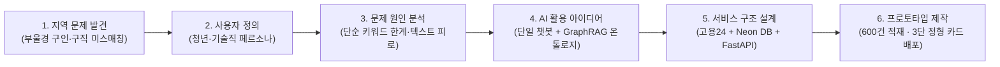
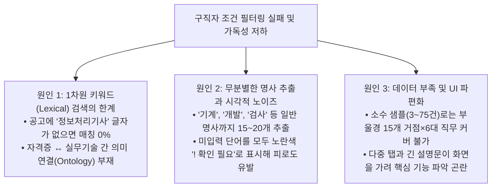
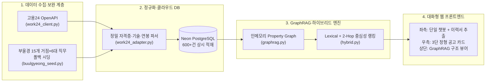

# 📊 부울경 채용 AI 매칭 · GraphRAG 프로젝트 발표자료 (PPT)

> [!TIP]
> **실제 파워포인트(`.pptx`) 파일 생성 완료:**
> - **PPTX 파일 경로:** [16_부울경_채용_AI_매칭_GraphRAG_발표자료.pptx](file:///C:/Users/user/.gemini/antigravity/scratch/job_mismatch/docs/16_부울경_채용_AI_매칭_GraphRAG_발표자료.pptx)
> - **PPT 생성 스크립트:** [generate_ppt.py](file:///C:/Users/user/.gemini/antigravity/scratch/job_mismatch/scripts/generate_ppt.py)
> - 아래 카루셀(Carousel) 슬라이드를 좌우로 넘기며 **전체 8장 슬라이드 구성과 다이어그램**을 바로 확인하실 수 있습니다.

---

````carousel
## Slide 1 · 표지 및 6단계 진행 흐름 (Overview)

### **부울경 채용 AI 매칭 챗봇 · GraphRAG**
*단일 대화형 챗봇과 2-Hop 지식 그래프(GraphRAG)를 활용한 설명 가능한 지역 채용 매칭 플랫폼*



- **실시간 배포 서비스:** https://jobmismatch.vercel.app
- **GitHub 저장소:** https://github.com/juny79/job_mismatch

<!-- slide -->

## Slide 2 · [STEP 1] 지역 문제 발견

### **부산·울산·경남(부울경) 일자리 미스매칭 현상**
*일자리가 없는 것이 아니라, 구직자의 역량과 지역 산단 기업의 공고가 연결되지 못하고 있습니다.*

| 핵심 지역 문제 | 상세 현상 및 데이터 관찰 |
| :--- | :--- |
| **1. 청년 인재 유출 vs 산단 구인난의 역설** | • 부울경에는 **센텀시티(IT), 녹산·사상(제조), 울산 테크노·온산(화공/전장), 창원·김해·거제(기계/방산/조선)** 등 15대 핵심 산업거점이 존재<br>• 지역 강소·중견기업은 상시 인력난을 겪으나, 구직자는 *"내 전공·자격증으로 갈 만한 기업이 없다"*고 체감 |
| **2. 자격증·학습 기술과 현장 공고 간 언어 장벽** | • 구직자는 **`정보처리기사`, `전기기사`, `품질경영기사`, `전산세무`** 등 자격증과 학습 기술 위주로 본인을 정의<br>• 반면 기업 공고는 **`MES/ERP 구축`, `PLC 제어`, `스마트팩토리 비전 검사`** 등 현장 용어로 작성되어 단순 검색 시 대거 누락 |
| **3. 파편화된 조건 정보 (연봉·복지·근무지)** | • 부울경 특성상 **통근버스, 기숙사, 산단 위치, 연봉 하한선**이 지원 결정의 핵심 요인<br>• 수백 건의 줄글 공고를 일일이 클릭해 읽어야만 확인 가능해 **탐색 피로도** 극심 |

<!-- slide -->

## Slide 3 · [STEP 2] 사용자 정의

### **누구의 어떤 페인포인트(Pain Point)를 해결하는가?**

#### 👨‍🎓 페르소나 A · 부울경 IT/SW 취업 준비생 (부산 센텀·창원 스마트산단 희망)
- **보유 역량:** `정보처리기사`, `SQLD` 자격증 보유 / `Python`, `Java` 학습
- **페인포인트:** 기존 검색에서 `정보처리기사`를 넣으면 매칭 0건이 뜨거나, 왜 추천되었는지 알기 어려움
- **핵심 니즈:** *"부산 + 소프트웨어/IT + 정보처리기사 + 3,500만원 이상만 선택하면 연관된 Python·Java·Spring 공고까지 한눈에 보고 싶다!"*

#### 👷‍♂️ 페르소나 B · 제조/설계/자동화 기술직 구직자 (울산·창원·김해·양산 산단 희망)
- **보유 역량:** `전기기사`, `기계설계산업기사`, `CAD` / `PLC` / `품질관리` 실무 경험 및 이력서 파일 보유
- **페인포인트:** 긴 공고 텍스트 속에서 요구 자격, 기숙사·통근버스 복지, 연봉을 빠르게 비교하기 어려움
- **핵심 니즈:** *"이력서 파일을 올리거나 챗봇 버튼 몇 번만 누르면 내 기술 일치 여부와 복리후생이 정형화된 표로 정리되면 좋겠다!"*

> [!IMPORTANT]
> **사용자 중심 3대 설계 요구사항**
> 1. **단일 챗봇 인터페이스**: 복잡한 다중 폼·카테고리를 배제하고 챗봇 대화창 하나로 통합
> 2. **즉각적인 실시간 피드백**: 챗봇에서 클릭할 때마다 오른쪽 공고 피드가 실시간으로 좁혀지는 경험
> 3. **무의미한 경고 제거 & 3단 정형 카드**: 노란색 경고 나열 대신 `[요구 기술·자격 / 주요 복리후생 / GraphRAG 연결]`로 깔끔하게 시각화

<!-- slide -->

## Slide 4 · [STEP 3] 문제 원인 분석

### **왜 기존 채용 검색과 초기 방식은 매칭에 실패했는가?**



<!-- slide -->

## Slide 5 · [STEP 4] AI 활용 아이디어 도출

### **GraphRAG 지식 그래프 + 온톨로지 확장 매칭 + 단일 챗봇의 결합**

1. **AI 핵심 1 · 인메모리 GraphRAG 지식 그래프 (`JobGraph`)**
   - 채용공고를 단순 텍스트가 아닌 **6종 노드(`공고`, `기업`, `지역`, `직무`, `기술·자격`, `복리후생`)**와 **5종 관계 엣지(`LOCATED_IN`, `HAS_ROLE`, `REQUIRES_SKILL`, `OFFERS_BENEFIT`, `POSTED_JOB`)**로 구조화
   - 600건 공고 기준 **1,000+개 노드와 13,000+개 관계**를 실시간 구축하여 근거 경로(Evidence Path) 제시
2. **AI 핵심 2 · 자격증↔기술 온톨로지(Ontology) 확장 및 2-Hop 중심성 랭킹**
   - **온톨로지 확장 탐색**: 사용자가 `정보처리기사`만 입력해도 직접 명시된 공고(`✓ 내 보유 일치`)뿐 아니라 동일 IT/SW 그래프 클러스터에 연결된 `Python`, `Java`, `Spring`, `SQL` 요구 공고까지 **`🔗 연관 기술 매칭`**으로 자동 확장
   - **2-Hop 중심성(Centrality) 가중치**: `공고 A → [기술/직무 노드] ← 공고 B`의 2-Hop 이웃 연결 밀도를 계산해 추천 점수(`Graph 점수`)에 합산
3. **AI 핵심 3 · 단일 매칭 챗봇 & 프라이버시 우선 브라우저 이력서 분석**
   - 4단계 대화(지역→직무→기술/자격→연봉) 및 **이력서(PDF/DOCX/TXT) 브라우저 내 즉시 기술 추출** (서버에 개인정보·원문 비저장)

<!-- slide -->

## Slide 6 · [STEP 5] 서비스 구조 설계

### **End-to-End 클라우드 데이터 파이프라인 및 아키텍처**



- **무중단 데이터 가용성 보장**: 고용24 OpenAPI 실시간 호출을 우선 수행하되, 해외 서버리스(Vercel) IP 제한이나 세부 API 권한 대기 시에도 부울경 15개 산단 거점 공고를 300건 단위로 즉시 보완 적재하여 **언제나 600건 이상의 풍부한 매칭 풀 유지**

<!-- slide -->

## Slide 7 · [STEP 6] 프로토타입 제작 및 작동 화면

### **실제 작동하는 웹 프로토타입 (https://jobmismatch.vercel.app)**

- **상단 바 (GraphRAG 실시간 상태 및 구조 뷰어)**
  - `● 적재 공고 600건 · GraphRAG 노드 1,071개 · 관계 13,639개 ▾ 구조 보기` 클릭 시 노드·엣지 상세 분포 드로어 오픈
  - `🔄 고용24 공고 +300건 더 가져오기` 클릭 시 즉시 추가 수집 및 그래프 재구축
- **좌측 패널 (단일 채용 매칭 챗봇)**
  - 우측 상단 고정 `[↺ 초기화]` 버튼 + 현재 수집된 조건 배지(`📍 지역: 부산`, `🏢 분야: 소프트웨어`, `🛠️ 내 기술: 정보처리기사`, `💰 최소연봉: 3500만원`)
  - 단계별 빠른 선택 칩(Quick Chips) + 자유 키워드 입력 + 하단 `📎 이력서 파일(PDF/DOCX/TXT)` 기술 추출
- **우측 패널 (가독성을 높인 3단 정형 채용공고 카드)**
  - **1행 `요구 기술·자격`**: `✓ 내 보유 일치: 정보처리기사`(초록) · `🔗 연관 기술 매칭: Python`(초록) · `🛠️ FastAPI`(회색)
  - **2행 `주요 복리후생`**: `🎁 유연근무` · `🎁 재택근무` · `🎁 중식제공` · `🎁 교육비지원`(보라)
  - **3행 `GraphRAG 연결`**: `📍 지역노드 → 부산 해운대구` · `🏢 직무노드 → 소프트웨어/IT · AI 개발` · `🏛️ 채용기업 → 센텀에이아이랩(주)`(파랑)

<!-- slide -->

## Slide 8 · 종합 요약 및 기대 효과

### **기존 채용 검색 vs 부울경 GraphRAG AI 매칭 비교**

| 비교 항목 | 기존 채용 포털 / 초기 방식 | 부울경 채용 AI 매칭 · GraphRAG (현재 구현) |
| :--- | :--- | :--- |
| **조건 입력 방식** | 복잡한 다중 필터·카테고리 직접 설정 | **단일 챗봇 4단계 대화 + 이력서 파일 원클릭 추출** |
| **검색·매칭 엔진** | 단순 단어 일치(Lexical) → 자격증 검색 시 누락 | **GraphRAG 지식 그래프(2-Hop) + 자격증↔기술 온톨로지 확장** |
| **공고 카드 시각화** | 긴 줄글 열람 또는 무의미한 `! 확인 필요` 경고 나열 | **`[요구 기술·자격 / 주요 복리후생 / GraphRAG 연결]` 3단 정형 카드** |
| **AI 투명성·안전성** | 블랙박스 추천 또는 환각(Hallucination) 우려 | **공고 원문 Evidence + 그래프 연결 경로 100% 투명 제시 (이력서 비저장)** |

### **기대 효과**
1. **부울경 구직자의 탐색 시간 획기적 단축**: 부산·울산·경남 15개 핵심 산업단지 공고를 내 자격증·기술과 즉시 연결
2. **설명 가능한 AI(XAI) 매칭**: 왜 이 공고가 추천되었는지 그래프 노드 경로로 명확히 설명하여 구직자 의사결정 지원
3. **즉시 운영 가능한 클라우드 아키텍처**: Vercel Serverless + Neon PostgreSQL 기반으로 지자체·대학 일자리센터에 즉시 도입 및 확장 가능
````
