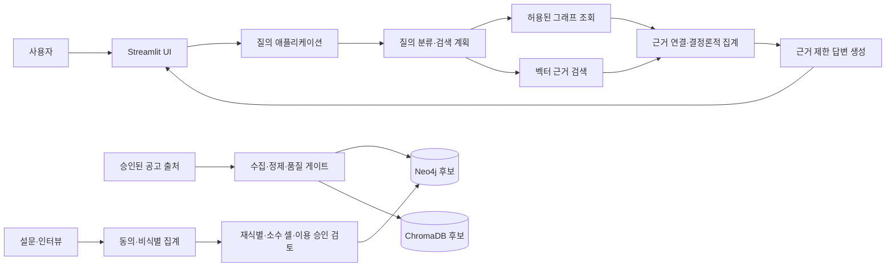

# 부울경 청년 일자리-기업 미스매칭 GraphRAG 챗봇 프로젝트 아키텍처 초안

> 상태: 설계 초안. 기술·DB·외부 모델 선택과 데이터 수집은 승인 및 검증 후 확정한다.
> 기준: `부울경 청년 일자리-기업 미스매칭 GraphRAG 챗봇 종합계획서.md`

## 1. 추진 배경과 목표 리마인드

15영업일 PoC의 목표는 부울경 기업의 채용 조건과 청년의 역량·근무·정주 선호에서 **자료로 확인되는 차이**를 탐색하는 GraphRAG 데모를 구축하고, 수집·정규화·검색·근거 표시의 기술적 타당성을 확인하는 것이다. 구조화된 공고 정보는 그래프 검색으로, 공고의 직무·자격·복지 서술은 벡터 검색으로 보완한다.

PoC 결과는 제한된 권역·직무·기간의 탐색 결과로만 해석한다. 부울경 전체 청년의 선호, 청년 유출 원인, 기업 구인난, 취업률 향상 또는 정책 효과를 입증하지 않는다. 근거가 부족하면 추측하지 않고 미확인·응답 보류로 표시한다.

## 2. 아키텍처 원칙

- **근거 우선:** 답변의 출처 ID, 게시 시점, 원문 근거 위치를 추적한다.
- **원문과 정규화 분리:** 원문을 보존하고 정규화 값·변환 이력·검수 상태를 별도 관리한다.
- **결정론적 집계:** 수치·분모·급여 통계는 검증된 쿼리와 애플리케이션 코드로 계산한다. LLM은 계산하지 않는다.
- **결측 보존:** 미기재·해당 없음·추출 실패·검수 대기를 구분한다. 미기재를 미제공으로 해석하지 않는다.
- **개인 응답 비노출:** 설문 개인 단위 자료는 그래프·벡터 검색에 적재하지 않고 승인된 비식별 집계만 사용한다.
- **최소 권한:** 앱의 DB 질의 권한은 읽기 전용으로 두며 적재 계정·비밀정보를 분리한다.
- **기술 선택은 조건부:** Neo4j·ChromaDB·Streamlit은 계획서의 기본 후보이며 비용·보안·팀 역량·이용 조건 확인 후 결정한다.

## 3. 전체 구성

## 4. 데이터 및 질의 흐름

### 4.1 적재

**허용된 출처 → 원본 스냅샷 → 스키마·중복·범위 검증 → 정규화 및 원문 근거 연결 → 사람 검수 → 버전 고정 → 그래프·벡터 적재** 순서로 진행한다. 출처 이용 조건이 불명확한 자료는 수집·외부 전송·적재하지 않는다. 설문 개인 응답은 적재 경로에서 제외한다. 승인된 비식별 집계도 동의 범위·분모·조사 기간·소수 셀 재식별 위험을 검토한 뒤 별도 승인 게이트를 통과해야 그래프 또는 분석 저장소에 반영한다.

### 4.2 질의

1. UI에서 질문과 필터를 받고, 선정 권역·직무·기간 범위인지 확인한다.
2. 질의 라우터가 공고 검색, 구조화 집계, 관계 탐색, 서술 검색, 비교 요청으로 분류한다.
3. 구조화 질의는 매개변수형 Cypher 템플릿을 우선 적용하고, 설명 검색은 출처 메타데이터가 연결된 벡터 검색을 사용한다.
4. 결과를 공고 ID로 연결하고 출처·게시일·검수 상태를 확인한다. 건수·비율은 코드에서 분모·단위·결측 처리를 포함해 계산한다.
5. LLM에는 검증된 근거 묶음만 제공한다. 근거 부족·범위 초과·검색 실패 시 미확인 또는 오류를 표시한다.
6. UI는 답변과 함께 근거 공고·출처·원문 구절·표본 범위·결측·한계를 제시한다.

## 5. 컴포넌트와 책임

| 컴포넌트 | 책임 |
| --- | --- |
| 수집기·출처 레지스트리 | 허가된 API·파일 수집, 출처·이용 조건·수집 시점 기록 |
| 파서·정규화기 | 날짜·지역·직무·급여·스킬·복지의 정규화 후보 생성 |
| 품질 게이트 | 범위·필수값·중복·결측·출처·검수 상태 확인, 승인·격리·제외 |
| 그래프 저장소 어댑터 | 공고·기업·직무·스킬·복지·지역 관계의 적재·조회 |
| 벡터 저장소 어댑터 | 허용된 공고 설명 청크·임베딩·메타데이터 검색 |
| 질의 라우터 | 검색 의도 분류, 안전한 검색 경로 선택 |
| 근거·집계 서비스 | 그래프·벡터 결과 연결, 출처 확인, 결정론적 수치 계산 |
| 답변 서비스 | 근거에 한정한 요약, 인용·불확실성 표시 |
| Streamlit UI | 질문·필터·답변·출처·표본·한계·시각화 표시 |
| 평가 도구 | 고정 테스트 질의·기대 근거·회귀 검증 |

## 6. 그래프 모델 초안

중심 노드는 `JobPosting`이며, 실제 근거가 확인된 관계만 적재한다.

| 노드 | 핵심 속성 |
| --- | --- |
| `JobPosting` | 내부·원천 ID, 제목, 게시·마감일, 경력·고용형태, 급여 원문·단위·범위, 출처·버전·검수 상태 |
| `Company` | 내부 기업 ID, 확인된 기업명, 식별 근거 |
| `Role` | 표준 직무 코드·명칭, 분류 버전, 원문 직무명 |
| `Skill` / `Benefit` | 정규 용어, 승인된 동의어, 사전 버전 |
| `Location` / `IndustrialComplex` | 근무지, 행정구역, 근거 기반 권역·산단 매핑 |
| `Source` | 출처 ID, 기관·서비스, 수집 시점, 이용 조건 참조 |
| `PreferenceAggregate` | 비식별 지표·범주, 값·표본 수·분모·세그먼트 정의·기간·질문지 버전·승인 상태 |

관계 후보: `Company-POSTED_JOB->JobPosting`, `JobPosting-HAS_ROLE->Role`, `JobPosting-REQUIRES_SKILL->Skill`, `JobPosting-OFFERS_BENEFIT->Benefit`, `Company-LOCATED_AT->Location`, `Location-WITHIN->IndustrialComplex`, `JobPosting-FROM_SOURCE->Source`, `PreferenceAggregate-ABOUT_ROLE->Role`. 필수/우대 구분과 원문 근거를 보존한다. 집계 노드는 출처·조사 버전과 승인 상태를 추적한다. 개인별 `SurveyResponse` 노드는 만들지 않는다.

급여 미기재·협의·단위 불명은 수치 기본값으로 대체하지 않는다. 공고 원문과 정규화 값, 출처 위치, 추출·검수 상태를 함께 유지한다. 표시명(예: 기업명)만을 고유 ID로 사용하지 않는다.

## 7. 권장 저장소 구조

| 경로 | 책임 |
| --- | --- |
| `src/app/` | UI와 애플리케이션 진입점 |
| `src/domain/` | 공고·스킬·출처 등 도메인 모델·검증 규칙 |
| `src/ingestion/` | 출처 커넥터, 파싱, 정규화, 품질 검사 |
| `src/retrieval/` | 그래프·벡터 검색, 질의 라우팅 |
| `src/answering/` | 근거 패키징, 집계, 답변 생성 |
| `src/storage/` | Neo4j·벡터 저장소 어댑터 |
| `tests/` | 단위·통합·안전성·검색 회귀 테스트 |
| `data/` | 로컬 원본·정제·인덱스(버전 관리 제외) |
| `docs/` | 계획서, 아키텍처, 결정·운영 기록 |
| `scripts/` | 검수·적재·재색인·개발 편의 스크립트 |

`config.yaml`과 자격증명은 커밋하지 않는다. `.gitignore`와 예시 설정 파일을 마련하고, 비밀정보는 환경변수 또는 승인된 저장소에서 주입한다. 실제 민감값은 문서·로그·테스트에도 넣지 않는다.

## 8. 안전 경계

- Text2Cypher를 사용하더라도 읽기 전용 계정, 허용된 라벨·관계·속성, 쿼리 검증, 시간·행 제한을 적용한다. 쓰기·관리 명령은 차단한다.
- 질문과 공고 원문은 신뢰할 수 없는 입력으로 취급한다. 검색 결과가 없거나 출처가 유효하지 않으면 답변을 제한한다.
- LLM·임베딩 외부 전송은 출처 이용 조건과 제공자 보안·보관 정책 승인을 통과한 최소 데이터에 한한다.
- 그래프와 벡터 인덱스는 같은 정제 데이터 버전으로 만들고 재적재·수정·삭제 동작을 함께 검증한다.
- UI·로그·시각화에 개인 응답, 비밀정보, 출처 조건상 공개 불가 정보가 나타나지 않도록 확인한다.

## 9. 단계별 구현 결정

| 단계 | 결정·산출물 | 통과 기준 |
| --- | --- | --- |
| A. 범위·환경 | 권역·직무·기간, 이용 가능한 출처, 저장 위치, 외부 모델 사용 여부 | 이용 근거·책임자·비밀정보 처리 확인 |
| B. 데이터 계약 | 필드 스키마, 출처 ID, 결측·검수·버전 방식 | 샘플 데이터 검수와 품질 기준 합의 |
| C. 저장소 | 그래프·벡터 DB와 제약조건·인덱스 | 동일 정제 버전 적재·재적재·출처 추적 확인 |
| D. 검색 MVP | 필터 검색, 집계 템플릿, 의미 검색, 근거 패키지 | 대표 질문에서 데이터·출처·수치 재현 |
| E. UI·검증 | 답변·인용·표본·한계 화면, 오류 처리, 안전성 테스트 | 9장 테스트 기준과 보안 게이트 충족 |

## 10. 미결정 사항과 첫 실행 게이트

| 미결정 항목 | 착수 시 결정 |
| --- | --- |
| 분석 권역·직무군·대상 기간 | Day 1에 데이터 확보 전망과 함께 확정 |
| 채용정보 출처·이용 조건 | 출처 대장에 기록하고 허용된 자료만 승인 |
| 설문 자료를 PoC에서 사용할 수 있는지 | 동의·표본·보관 절차가 준비되지 않으면 설문 비교 기능 제외 |
| Neo4j·ChromaDB·LLM 사용 여부 | 로컬·클라우드·외부 전송 조건과 비용 검토 후 확정 |
| 자유 자연어 쿼리 지원 수준 | 기본은 템플릿·필터 검색. 보안 검증 전 임의 Text2Cypher 노출 금지 |
| `config.yaml` 처리 | 민감값 포함 여부 확인 전에는 열람·추가·커밋하지 않고 `.gitignore` 적용 |

**첫 번째 실행 게이트:** 권역·직무·기간·출처·이용 조건을 결정하고, 허용된 샘플 데이터를 소량 확보해 스키마·결측·중복·검색 질문을 검증한다. 이 게이트 통과 전에는 실제 서비스 계정·외부 모델·대량 수집을 연결하지 않는다.

### 10.1 아키텍처 검토 결과와 진행 상태

계획서와 대조한 결과, 제한된 PoC 범위, 출처 기반 검색, 원문·정규화 분리, 결정론적 집계, 안전한 검색, 검증 게이트는 계획과 일치한다. 설문 집계는 동의·재식별·소수 셀·이용 승인 검토 후에만 저장소에 반영하도록 흐름을 명시했다. 기술 선택과 실제 데이터 처리는 아직 승인 전이며 완료된 것으로 간주하지 않는다.

| 계획서상 선행 결정 | 현재 상태 | 다음 절차 |
| --- | --- | --- |
| 분석 권역 1곳·직무군 1~2개·대상 기간 | 미확정 | 사용자·도메인 담당 합의 후 기록 |
| 채용공고 출처·수집 방법·재사용/외부 전송 권한 | 미확정 | 출처별 이용 조건 확인 전 수집하지 않음 |
| 설문 자료 사용 여부·동의·모집·보관 절차 | 미확정 | 승인·유효 표본이 없으면 설문 비교 기능 제외 |
| 그래프·벡터 DB·LLM·개발환경 | 후보만 존재 | 비용·보안·팀 역량·데이터 경로 확인 후 결정 |
| 샘플 데이터 품질·500건 확보 전망 | 미검증 | 이용 승인된 소량 샘플로 Day 2 파일럿 후 범위 게이트 |

이 문서는 아키텍처 검토·설계 단계의 산출물이다. 첫 번째 실행 게이트가 승인되기 전에는 수집기 구현, 공고 수집, 외부 모델 호출, 서비스 계정 생성, 비밀정보 입력을 진행하지 않는다.

### 10.2 산업·고용 거점 후보 1차 스크리닝

아래는 공식 최신 통계로 순위를 확정한 결과가 아니라, 데이터 검증을 시작하기 위한 **후보 목록**이다. 산업단지의 입주업체 수나 명성만으로 ‘가장 활성화’ 또는 근로자 수 순위를 단정하지 않는다. 같은 기준 연도·분기의 고용인원, 가동업체 수, 지역별 사업체 종사자 수를 확보한 뒤 최종 선정한다.

| 시도 | 우선 검증 후보 | 비교 후보 | 후보를 둔 이유·검증 범위 |
| --- | --- | --- | --- |
| 부산 | 강서구 녹산국가산업단지 | 사상공업지역, 강서구 명지·녹산 업무·산업권, 센텀시티 업무권 | 제조업 집적 후보와 사무·서비스 일자리권을 구분해 비교. 센텀시티는 산업단지가 아닌 업무권 후보로 분리 |
| 울산 | 울산·미포국가산업단지 | 온산국가산업단지, 남구·북구·동구 사업체 밀집권 | 자동차·조선·석유화학 등 산업별 고용 분포와 산단별 고용을 확인. 행정구역 종사자 수와 산단 통계를 혼합하지 않음 |
| 경남 | 창원국가산업단지 | 김해 산업단지 집적권, 양산 산업단지 집적권, 사천 항공우주산업 집적권 | 창원 기계·방산 등 제조업과 김해·양산의 제조 집적, 사천의 항공우주 특화 후보를 구분해 검증 |

이 후보군은 비교·조사 범위를 정하기 위한 출발점일 뿐, 현재 이 계획서에서 확정한 분석 대상이나 공식 고용 순위가 아니다. 15영업일 PoC 기본 범위는 권역 1곳·직무군 1~2개이므로 부산·울산·경남 전체를 한 번에 분석하는 것은 기본 일정의 범위를 넘는다. 우선 통계를 비교해 한 권역을 선택하고, 나머지는 후속 실증 후보로 남긴다.

**통계 검증 절차**

1. 한국산업단지공단의 산업단지 통계에서 후보별 동일 기준 시점의 가동업체·입주업체·고용인원을 확인한다. 산업단지 통계는 산업단지 경계 내 사업장만 포함하는지 범위를 확인한다.
2. KOSIS 전국사업체조사 등에서 시군구·산업별 사업체 종사자 수를 확인한다. 이 값은 사업장 소재지 기준으로 보고, 거주자 수·경제활동인구와 혼동하지 않는다.
3. 허용 조건을 확인한 채용정보 자료에서 대상 기간·직무군별 공고 수와 채용 규모를 비교 보조지표로 추출한다. 공고 수는 해당 출처의 수집 범위이지 전체 채용 규모가 아님을 표시한다.
4. 기준 연도·분기, 공간 경계, 산업분류, 누락·집계 방식을 맞춘 뒤 지표별 순위를 산출한다. 서로 다른 정의의 수치는 합산하지 않는다.
5. 지표와 출처의 가용성을 보고 분석 대상 1곳을 선정하고, 선택 근거·제외 후보·자료 한계를 기록한다. 최신 동시점 자료를 확보할 수 없으면 순위를 발표하지 않고 ‘후보 스크리닝’으로 남긴다.

공식 자료 확인 출발점: [한국산업단지공단](https://www.kicox.or.kr/), [KOSIS 국가통계포털](https://kosis.kr/), [고용24](https://www.work24.go.kr/). 실제 사용 전 각 통계표의 기준 시점·공간 정의와 API·자료 재사용 조건을 확인한다.
